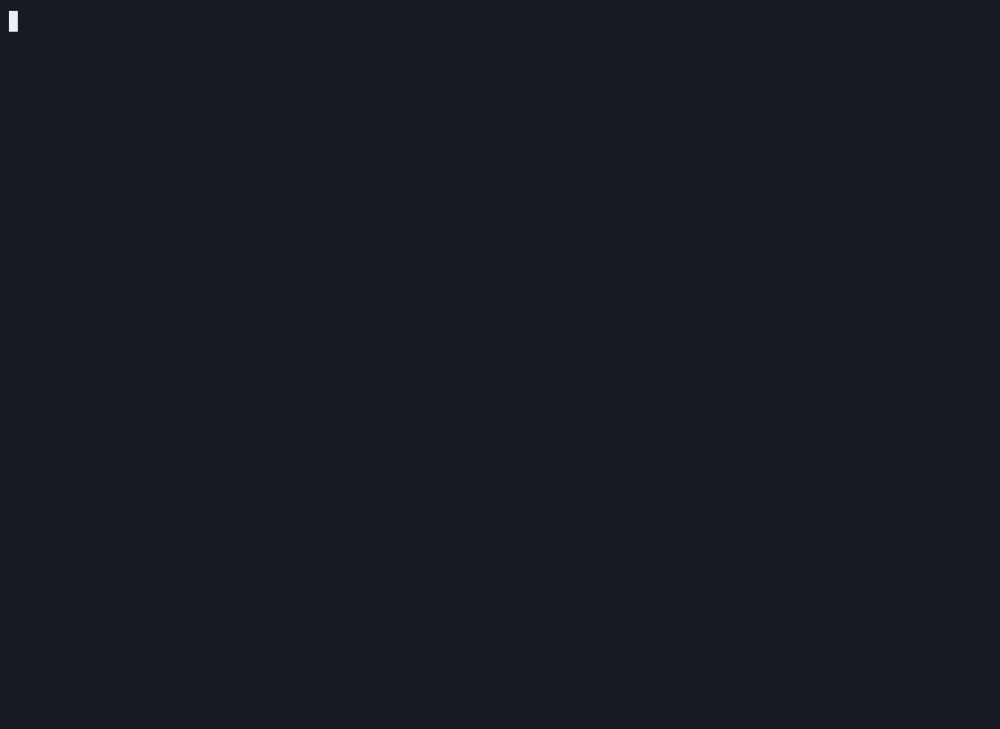

<!-- mcp-name: io.github.AdityaTummuri/qedcode -->
<div align="center">

<picture>
  <source media="(prefers-color-scheme: dark)" srcset="https://raw.githubusercontent.com/AdityaTummuri/QEDCode/main/assets/logo-dark.svg">
  
</picture>

### Your AI says it's fixed. QEDCode makes it prove it.

QEDCode grades every AI code change from evidence, not from what the agent says. It catches changes
that weaken their tests, flags fixes that nothing proves, and writes a receipt anyone can re-run.
**No model, no GPU, no account.**

[](https://github.com/AdityaTummuri/QEDCode/actions/workflows/ci.yml)
[](https://pypi.org/project/qedcode/)


[Docs](https://adityatummuri.github.io/QEDCode/docs/) ·
[Try it in your browser](https://adityatummuri.github.io/QEDCode/play/) ·
[Results](https://github.com/AdityaTummuri/QEDCode/blob/main/docs/results.md) ·
[Start here if you use Claude Code or Cursor](https://github.com/AdityaTummuri/QEDCode/blob/main/docs/start-here.md) ·
[Open in Codespaces](https://codespaces.new/AdityaTummuri/QEDCode?quickstart=1)

</div>

<p align="center">
  <br>
  <sub>A real run, not scripted: qwen3.5:4b on an RTX 4050 laptop (6 GB) via Ollama, shown at 3x speed.</sub>
</p>

## Try it

```bash
uvx qedcode try      # three AI "fixes" to one bug, graded in a few seconds
uvx qedcode check    # grade the uncommitted changes in your repository
uv tool install qedcode                # keep it: `qed` on your PATH
```

Until the package is on PyPI, put `--from git+https://github.com/AdityaTummuri/QEDCode` after `uvx`.

```text
An AI agent "fixed" one bug three times. QEDCode grades each change (no model).

  change 1   C  Caught    skipped the failing test instead of fixing the code
  change 2   B  Unproven  5/5 pass, but none failed before the fix
  change 3   A  Proven    a new test failed before, passes now · 7/7 pass

  qed verify <receipt of change 3>  ->  VERIFIED on this machine
```

| Result | What it means |
| --- | --- |
| **Caught** | a test was skipped, weakened, deleted or edited to make the change look green |
| **A** Proven | a new test failed before the change and passes after it; the full suite still passes |
| **B** Unproven | the tests pass, but nothing shows the bug is fixed |
| **C** Untested | no test runs the changed code |
| **D** Not checked | nothing could run, and it says why |

Why: passing tests is not the same as fixed. Maintainers would not merge about half of the agent
patches that pass SWE-bench Verified's tests
([METR, 2026](https://metr.org/notes/2026-03-10-many-swe-bench-passing-prs-would-not-be-merged-into-main/)).

**What it does not catch:** code that special-cases the test inputs, and a wrong fix whose own new
test encodes the same mistake. No check that only sees the change can; hidden tests can.

## Put it where AI code lands

- **Every pull request:** `uses: AdityaTummuri/QEDCode@v0.2.0` fails on Caught and comments the rest
  ([GitHub Action](https://github.com/AdityaTummuri/QEDCode/blob/main/docs/github-action.md)).
- **Your agent's stop step:** `qed hook install claude` sends Claude Code back to work once when it
  tries to stop with a test weakened or broken ([agents](https://github.com/AdityaTummuri/QEDCode/blob/main/docs/agents.md)).
- **Want the fix written too?** `qed solve "fix the login bug"` runs a local model through the same
  checks in a throw-away copy and hands you a graded fix, or "no fix". Nothing touches your files
  until `qed apply`, and `qed undo` takes it back out.

## Results

<!-- results:start -->
First look, on a 6 GB laptop with Ollama (two small, easy suites, 3 repetitions): no significant
change in how many tasks get solved, **grade A was right 86 of 89 times**, and **silent failures
fell from 11 to 4**. The bigger runs are still to come.
[Details and reports](https://github.com/AdityaTummuri/QEDCode/blob/main/docs/results.md).
<!-- results:end -->

## Works with

Claude Code · Cursor · OpenCode · Cline · Antigravity · VS Code (through MCP: `qed connect`) ·
GitHub Actions ([QEDCode Check](https://github.com/AdityaTummuri/QEDCode/blob/main/docs/github-action.md)) · pre-commit · llama.cpp · Ollama ·
LM Studio · any cloud model through LiteLLM. Python (pytest) and JavaScript/TypeScript
(`node --test`, Vitest, Jest) projects on macOS, Linux and Windows.

## Learn more

| | |
| --- | --- |
| [Install](https://github.com/AdityaTummuri/QEDCode/blob/main/docs/install.md) | per-OS install, first run, `qed doctor`, tested hardware |
| [Using QEDCode](https://github.com/AdityaTummuri/QEDCode/blob/main/docs/usage.md) | every command, the speed dial, languages, models and modes |
| [Agents](https://github.com/AdityaTummuri/QEDCode/blob/main/docs/agents.md) | use it from Claude Code, Cursor, Antigravity and others |
| [GitHub Action](https://github.com/AdityaTummuri/QEDCode/blob/main/docs/github-action.md) | grade every pull request; pre-commit hook |
| [How it works](https://github.com/AdityaTummuri/QEDCode/blob/main/docs/how-it-works.md) | the ladder, the grade rules, how it compares, architecture |
| [Safety model](https://github.com/AdityaTummuri/QEDCode/blob/main/docs/safety.md) | worktrees, a model that never runs commands, receipts as data |
| [Receipts](https://github.com/AdityaTummuri/QEDCode/blob/main/docs/receipts.md) | the open proof format and the Receipt Viewer |
| [FAQ](https://github.com/AdityaTummuri/QEDCode/blob/main/docs/faq.md) and [Troubleshooting](https://github.com/AdityaTummuri/QEDCode/blob/main/docs/troubleshooting.md) | |

<!-- stats:start -->
<!-- stats:end -->

## Develop

```bash
uv sync && uv run pytest -m "not gpu"     # no GPU, no network: a scripted model stands in
```

The build rules live in [AGENTS.md](https://github.com/AdityaTummuri/QEDCode/blob/main/AGENTS.md); [PROGRESS.md](https://github.com/AdityaTummuri/QEDCode/blob/main/PROGRESS.md) records what is done and
what still needs real hardware. See [CONTRIBUTING.md](https://github.com/AdityaTummuri/QEDCode/blob/main/CONTRIBUTING.md).

## License

[Apache License 2.0](https://github.com/AdityaTummuri/QEDCode/blob/main/LICENSE); see [NOTICE](https://github.com/AdityaTummuri/QEDCode/blob/main/NOTICE). Versions up to and including commit `a7fbe17`
were released under the GNU GPL-3.0.
