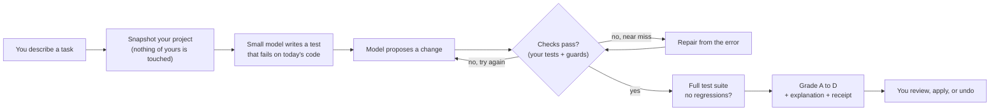
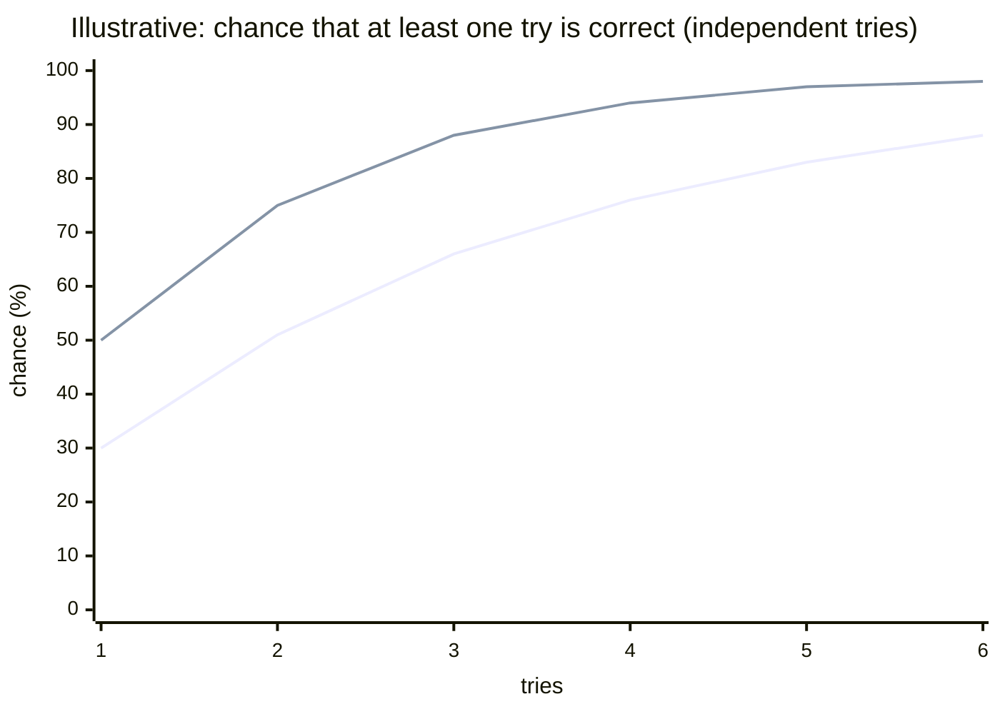
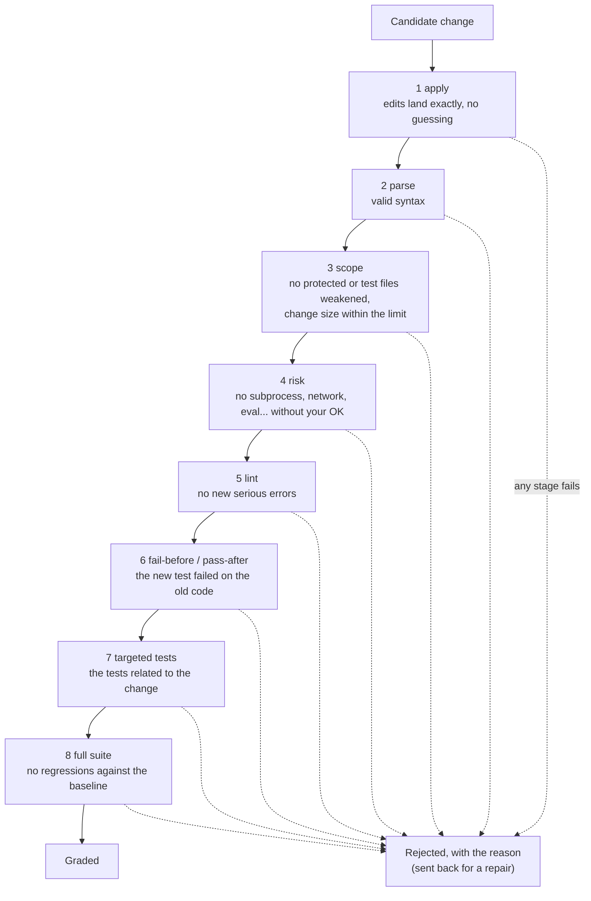
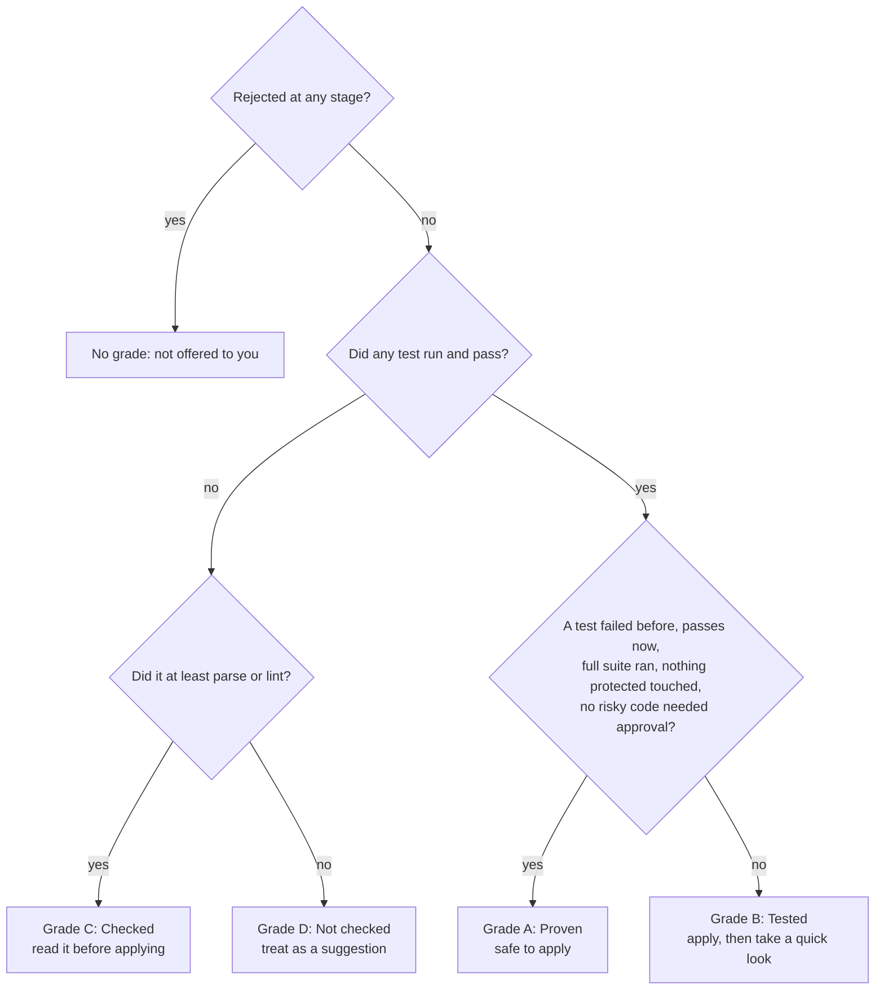
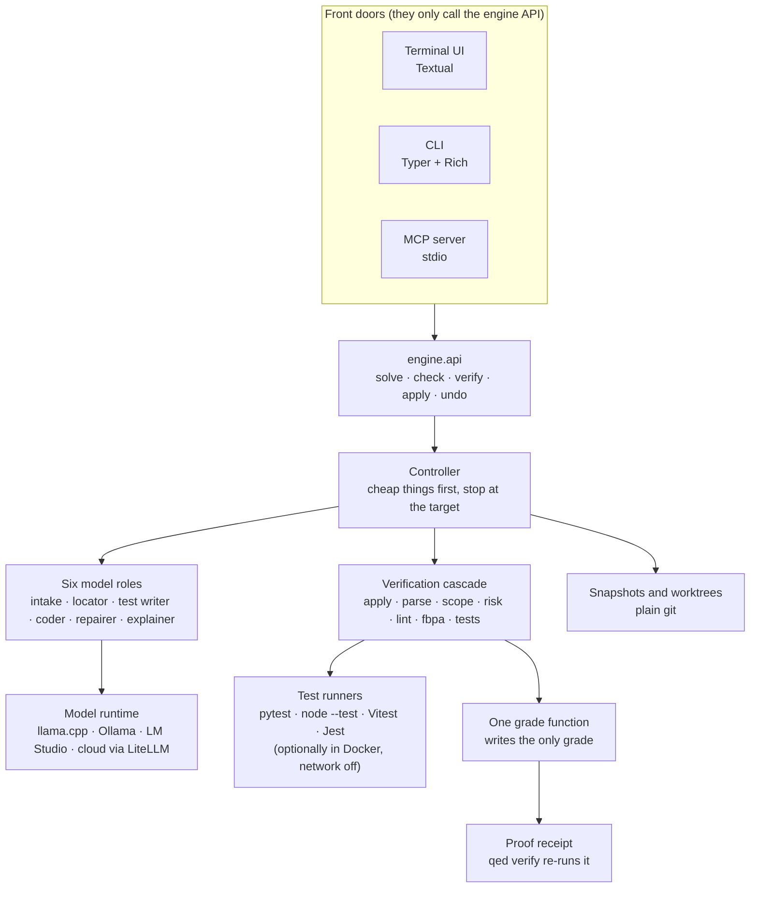
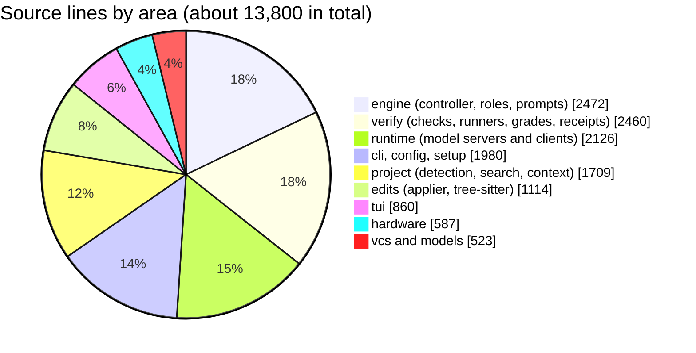

<div align="center">

<picture>
  <source media="(prefers-color-scheme: dark)" srcset="assets/logo-dark.svg">
  
</picture>

### Small local models. Proven fixes.

**A local-first coding engine that does not trust a model's first answer.**
It asks for several candidate changes, tests each one in a safe copy of your project, and hands you
only the best *verified* change, with a grade, a plain-English explanation and a receipt anyone can re-run.


</div>

<!-- DEMO: replace this line with a short screen recording (docs/demo.gif) of `qed solve` reaching grade A. -->

> **Status.** The engine, terminal UI, CLI and MCP server are complete and covered by 1,118
> automated tests that use a scripted stand-in model. Checks that need real hardware (GPUs, real
> model quality, Docker, Windows and Linux machines) are listed in `PROGRESS.md`. Please run
> `qed doctor` and report anything it cannot fix.

**Jump to:** [Name](#the-name) · [The idea](#the-idea-in-one-picture) · [A real session](#a-real-session) ·
[How it is judged](#how-a-candidate-is-judged) · [Comparison](#how-it-compares) ·
[Under the hood](#under-the-hood) · [Install](#install) · [First run](#first-run) ·
[Commands](#commands) · [Use with agents](#use-with-agents) · [Safety](#safety) ·
[Troubleshooting](#troubleshooting)

## The name

**QED** is the Latin *quod erat demonstrandum*, "which was to be demonstrated": the line a
mathematician writes when a proof is finished. That is the promise of this tool. A model *claims* a
fix; QEDCode makes it *demonstrate* the fix. A grade **A** is a finished proof: a test that failed
before the change passes after it, nothing else broke, and no test was weakened to get there.

## The idea in one picture

Small models (4–6 GB of VRAM) are fast and private, but they are wrong often enough that you cannot
trust a single answer. Checking an answer is far cheaper than writing a good one. QEDCode turns that
gap into reliability: **generate several, verify every one with deterministic tools, keep the best.**



Why that works, in numbers you can reason about. If one try is right with probability *p*, and
tries were independent, the chance that at least one of *k* tries is right is 1 − (1 − *p*)^*k*.
Verification is what lets you *use* that: without checks you cannot tell which try was the right one.



*The two lines are a model that is right 30% and 50% of the time on its first try. This is
arithmetic, not a measurement: real tries are correlated, so real curves are flatter. QEDCode's
speed dial stops at 1, 3 or 6 tries and quits as soon as a try is proven, so easy tasks stay quick.*

## A real session

This is the output of QEDCode working on one of its own test projects (a `paginate` function that
drops the last item of every page). It was recorded with the scripted stand-in model the automated
tests use, so it shows the engine's real behaviour and wording, not real-model speed or quality.

```text
$ qed solve "paginate drops the last item"
Taking a snapshot of your project...
Finding files ...... src/shop/pages.py
Running all your tests to see what already passes...
Writing a test that shows the problem ... done (it fails now)
Try 1: asking the model (temperature 0.2)...
  c1 · apply:    Edits applied to src/shop/pages.py.
  c1 · parse:    2 changed file(s) parse.
  c1 · scope:    2 file(s), 11 changed line(s), all within scope.
  c1 · risk:     No risky patterns in the new code.
  c1 · lint:     No new serious lint errors in 2 file(s).
  c1 · fbpa:     1 test(s) failed before the change and pass now.
  c1 · targeted: 7/7 tests pass.
Running all tests on c1...
  c1 · full:     7/7 tests pass.
Grade A · repro test failed before, passes now · 7/7 tests pass · lint clean · no protected files changed
```

```diff
 def paginate(items, page, size):
     start = (page - 1) * size
-    end = start + size - 1
+    end = start + size
     return list(items[start:end])
```

Along with the fix it adds the test that proves it, and saves a receipt. `qed verify` re-checks the
patch's checksum, then re-runs the tests on the original code and on the patched code in fresh
copies, and reports `VERIFIED` only if every recorded result still holds. A receipt is treated as
data, never as a list of commands: `qed verify` only runs your project's own test command on test
files inside the project, so a receipt someone hands you cannot start anything else:

```text
$ qed verify .qed/receipts/<task id>.json
VERIFIED
Grade A · repro test failed before, passes now · 7/7 tests pass · lint clean · no protected files changed
```

## How a candidate is judged

Every candidate walks the same ladder, **cheapest check first**. The first failing check rejects it,
so bad answers cost almost nothing, and only a strong candidate ever reaches the full test suite.



A single function decides the grade, and it never gives credit without evidence:



| Grade | Meaning | What to do |
| --- | --- | --- |
| **A** Proven | A test failed before, passes now, the full suite shows no regressions, nothing protected changed | Safe to apply |
| **B** Tested | The tests pass, but nothing proved the exact problem | Apply, then take a quick look |
| **C** Checked | The code parses (and lints for Python), but no test covers the change | Read the change before applying |
| **D** Not checked | No check could run, and it says why | Treat it as a suggestion |

## How it compares

Different tools make different promises. This compares **what each design guarantees**, not how fast
or how smart any particular product is. (We have not run a head-to-head benchmark yet; when we do,
the numbers will go here.)

| | Ask a model once | A general coding agent | **QEDCode** |
| --- | --- | --- | --- |
| Who decides the answer is right? | You, by reading it | The model, from its own run of the code | **Deterministic checks**: parse, lint, your tests, a test that failed before |
| Can the model run commands? | n/a | Yes, it chooses them | **No.** Only fixed commands built by QEDCode run |
| Where does generated code run first? | Your files, after you paste it | Often your working tree | **A throw-away git copy.** Your tree changes only on `apply`, and `undo` reverses it |
| Can it "pass" by weakening a test? | You may not notice | Possible | **Rejected:** editing, deleting or skipping existing tests is blocked |
| Evidence you can hand to someone | None | A chat log | **A proof receipt** that `qed verify` re-runs on any machine |
| Needs a big cloud model? | Usually | Usually | **No:** designed for 4–6 GB local models; cloud is opt-in |
| Your code leaves your computer? | Often | Often | **Never in local mode;** mix and cloud mode ask first |
| Learns from your project | No | Varies | **Yes:** applied fixes become examples, stored only on your computer |
| Works from your editor/agent | n/a | Is the agent | **Both:** terminal UI, CLI, and an MCP server that other agents call as a tool |

QEDCode is also **complementary**: Claude Code, OpenCode, Cline and Cursor can call it through MCP
(`qed connect`), so a large agent gets a verified, graded fix with a receipt instead of unchecked text.

## What you get

| | |
| --- | --- |
| **Proof, not promises** | Every result has a grade A–D, a plain-English explanation and a receipt that `qed verify` re-runs |
| **Your files stay yours** | Work happens in git worktrees; `qed apply` and `qed undo` are the only things that write to your tree, and they refuse if a file changed |
| **Built for small models** | Runs 2B–9B models in 4–6 GB of VRAM through llama.cpp, Ollama or LM Studio; cloud and a stronger helper model are optional |
| **Python and JS/TS** | pytest, `node --test`, Vitest and Jest; symbol-level edits with `ast` and tree-sitter |
| **Test tampering blocked** | A candidate cannot edit, skip or weaken existing tests to look green |
| **Speed dial** | `fast`, `normal` (default) and `sure`: one, three or six tries |
| **Learns your project** | Applied A/B fixes are shown to the local model as examples next time |
| **Sealed test box** | Optional: run tests in Docker with the network off |
| **Quiet mode** | Cooler, quieter laptop runs: fewer threads, low priority, short pauses |
| **Terminal UI, CLI and MCP** | One engine behind three front doors; one shared model server |
| **A doctor and a clean exit** | `qed doctor` fixes what it can explain; `qed uninstall --all` removes everything it installed |

## Under the hood



Two rules shape everything: **the engine never imports a UI** (so the terminal UI, the CLI and MCP
cannot drift apart), and **the model never runs commands** (it only returns text edits that a strict
applier checks).

| Layer | What we use |
| --- | --- |
| Language and packaging | Python 3.12, `uv`, hatchling |
| Terminal UI and CLI | Textual, Typer, Rich |
| Data and config | Pydantic v2, TOML, YAML |
| Local models | llama.cpp (`llama-server`), Ollama, any OpenAI-compatible server (LM Studio) |
| Cloud models | LiteLLM; keys live in the OS keychain (`keyring`) |
| Code understanding | Python `ast`, tree-sitter (JavaScript, TypeScript) |
| Testing and linting of your project | pytest, `node --test`, Vitest, Jest, ruff |
| Hardware and processes | psutil, nvidia-ml-py (optional), HTTP via httpx, Hugging Face Hub for model downloads |
| Agent integration | Model Context Protocol (MCP) |
| Isolation | git worktrees; optional Docker with `--network none` |

It is a real piece of software, not a prototype: about **13,800 lines of source** and **12,000
lines of tests** (1,118 automated tests), and no test needs a GPU, a network or a real model.



## What you need

| | Required | Notes |
| --- | --- | --- |
| Git | yes | QEDCode works in git worktrees and needs a repository with at least one commit (it offers to set one up) |
| Python 3.11+ | yes | `uv` installs and manages it for you |
| A project with tests | recommended | Python (pytest) or JavaScript/TypeScript (`node --test`, Vitest or Jest). Without tests the best grade is C |
| Node.js 20+ | JavaScript/TypeScript projects | 22.18+ to run `.ts` tests with the built-in runner |
| A GPU | recommended | NVIDIA (CUDA), AMD or Intel (Vulkan), Apple Silicon (Metal). CPU-only works but is slow |
| Docker | optional | only for the sealed test box (`qed sandbox setup`) |
| Disk space | 3–6 GB | the model; QEDCode shows the exact size and asks before every download |

## Install

QEDCode is installed as a command-line tool with [uv](https://docs.astral.sh/uv/). Pick your system.
(Once the first release is on PyPI, `uv tool install qedcode` or `pipx install qedcode` will work
too; until then install straight from GitHub as shown.)

### macOS

```bash
# 1. git (skip if `git --version` already works)
xcode-select --install
# 2. uv
brew install uv                                  # or: curl -LsSf https://astral.sh/uv/install.sh | sh
# 3. QEDCode
uv tool install git+https://github.com/AdityaTummuri/QEDCode
qed --version
```

Apple Silicon Macs use the Metal build of the model engine automatically. API keys are stored in the
macOS Keychain.

### Linux

```bash
# 1. git and curl (Debian/Ubuntu shown; use your package manager)
sudo apt install git curl
# 2. uv
curl -LsSf https://astral.sh/uv/install.sh | sh        # then open a new terminal
# 3. QEDCode
uv tool install git+https://github.com/AdityaTummuri/QEDCode
qed --version
```

GPU drivers: NVIDIA needs the proprietary driver (`nvidia-smi` must work); AMD and Intel use the
Vulkan build, so install your distribution's Vulkan driver (for example `mesa-vulkan-drivers`).
API keys go into the system keyring (Secret Service, for example GNOME Keyring or KWallet); on a
server without one, set the provider's usual environment variable instead (for example
`OPENAI_API_KEY`).

### Windows

Use PowerShell (Windows Terminal recommended).

```powershell
# 1. git (skip if `git --version` already works)
winget install --id Git.Git -e
# 2. uv
powershell -ExecutionPolicy ByPass -c "irm https://astral.sh/uv/install.ps1 | iex"
# 3. open a NEW PowerShell window, then install QEDCode
uv tool install git+https://github.com/AdityaTummuri/QEDCode
qed --version
```

NVIDIA GPUs use the CUDA build (keep the driver up to date); AMD and Intel GPUs use the Vulkan
build. API keys go into Windows Credential Manager. For JavaScript/TypeScript projects QEDCode links
your `node_modules` into its test copies; if Windows refuses to create the link, turn on Developer
Mode (Settings > For developers).

### Update or remove

```bash
uv tool upgrade qedcode          # update (for the GitHub install: uv tool install --force git+https://github.com/AdityaTummuri/QEDCode)
qed uninstall --all              # remove .qed/ here, ~/.qedcode (engines, models, logs, keys) ...
uv tool uninstall qedcode        # ... then the program itself
```

### From a clone (for developers)

```bash
git clone https://github.com/AdityaTummuri/QEDCode && cd QEDCode
uv sync
uv run qed --version
```

## First run

```bash
qed setup
```

`qed setup` finds your hardware, recommends a model and context size that fit your VRAM, lists
everything it wants to download with sizes, and asks once. Then it loads the model and prints a
test answer with tokens per second. It also lets you:

- use a model you already run in **Ollama** or **LM Studio** instead of downloading one,
- pick a **cloud** model (your API key goes into the system keychain, never into a file),
- set up a **helper** model for hard tasks, and
- connect QEDCode to your coding agents (Claude Code, OpenCode, Cline, Cursor).

Run `qed doctor` at any time: it checks git, your project's Python or Node, the test runner, ruff,
your GPU, the model engine, the model, the model server and free disk space, and tells you how to
fix whatever is wrong.

## A first task

```bash
cd your-project            # a git repository with a first commit
qed                        # opens the terminal UI (it confirms what it detected, once)
```

Type what you want ("fix the bug where the last item of a page is dropped") and press Enter. Watch
the tries, then press `d` to see the diff, `e` for the explanation, `a` to apply and `u` to undo.

Or from a script or terminal:

```bash
qed solve "paginate drops the last item" --speed normal      # nothing is applied
qed apply                                                    # apply the result (asks if the grade is low)
qed undo                                                     # take it back out
qed check                                                    # grade changes you made yourself
qed verify .qed/receipts/<task id>.json                      # re-run a proof receipt
```

## Languages

| | Python | JavaScript / TypeScript |
| --- | --- | --- |
| Detected from | `pyproject.toml`, `pytest.ini`, tests | `package.json` with no Python project beside it |
| Tests run with | pytest in your project's Python | `node --test`, Vitest or Jest (from your `node_modules`; QEDCode never installs Node packages) |
| Edits | symbols located with `ast` | symbols located with tree-sitter (`.js .jsx .mjs .cjs .ts .tsx .mts .cts`) |
| Checks | parse, ruff, tests | parse, tests (no linter) |
| Sealed test box (Docker) | yes | no |

## Models and modes

| Mode | What runs where |
| --- | --- |
| **local** (default) | everything on your computer, nothing is sent out |
| **mix** | local model first; a stronger helper model is asked only when the local one is stuck and you agree (parts of your code are sent to it) |
| **cloud** | a cloud model does the work (through LiteLLM; OpenRouter, Anthropic, OpenAI, Gemini or any provider string) |

Local models: the built-in catalog (`qed models list`) has Qwen3.5 9B/4B/2B and Qwen2.5-Coder 7B,
chosen to fit your VRAM (`qed models recommend`). QEDCode runs them with llama.cpp (one shared server
per computer), or uses Ollama or any OpenAI-compatible server such as LM Studio.

## Commands

```text
qed                                   open the terminal UI in the current folder
qed setup [--reset]                   hardware, mode, model, downloads, helper, API keys, agents
qed solve "<task>" [--speed fast|normal|sure] [--apply] [--json] [--allow-risky]
qed check [--speed ...] [--base <ref>] [--json]    grade the changes you made yourself
qed verify <receipt.json>             re-run a proof receipt: VERIFIED or what no longer matches
qed apply [task id] / qed undo        apply a finished result / take the last apply back out
qed models [list|recommend|download <id>|use <id>|remove <id>]
qed connect [agent] [--list] [--yes]  connect QEDCode to Claude Code, OpenCode, Cline, Cursor
qed quiet [on|off|auto]               gentler, cooler model runs (slower)
qed sandbox [status|setup|off]        run your tests in Docker with the network off
qed memory [list|forget <#>|clear]    the fixes QEDCode remembers and shows the model as examples
qed doctor [--update-engine]          check git, Python, pytest, ruff, GPU, engine, model, disk
                                      and say how to fix each problem
qed uninstall [--all] [--yes]         remove .qed/ here (--all: also ~/.qedcode and saved keys)
qed mcp                               the MCP server over stdio (see below)
```

In the terminal UI: type a task and press Enter, then `a` apply, `d` diff, `e` explain, `h` try
harder, `u` undo, `r` receipt, `m` speed, `s` settings, `Esc` cancel, `?` help.

## Use with agents

QEDCode is also an MCP server, so Claude Code, OpenCode, Cline, Cursor and other agents can call it
as a tool. They get the fix, its grade and the proof receipt, and the model server is shared with the
terminal UI (only one `llama-server` runs).

```bash
qed connect                              # finds your agents, shows what changes, asks first
claude mcp add qedcode -- qed mcp        # the same thing for Claude Code by hand
```

`qed connect` (and the last step of `qed setup`) handles four agents: it runs `claude mcp add`
for Claude Code, runs `opencode mcp add` for OpenCode, and merges a `qedcode` entry into Cline's CLI
settings file and Cursor's `~/.cursor/mcp.json` (with a backup copy; a file that is not plain JSON
is never touched, you get the snippet instead). `qed connect --list` shows what is connected.

For other agents add an MCP server that runs the command `qed` with the argument `mcp`. Their config
formats change, so check each tool's docs:

| Agent | Docs | Snippet |
| --- | --- | --- |
| OpenCode | https://opencode.ai/docs/mcp-servers | `{"mcp": {"servers": {"qedcode": {"type": "local", "command": ["qed", "mcp"]}}}}` |
| Cline | https://docs.cline.bot/mcp/mcp-overview | `{"mcpServers": {"qedcode": {"command": "qed", "args": ["mcp"]}}}` |
| Cursor | https://cursor.com/docs (search for "MCP") | `{"mcpServers": {"qedcode": {"command": "qed", "args": ["mcp"]}}}` |

Then ask your agent, for example: *"Use the qedcode tool to fix the bug described in task.txt"* or
*"I changed the code; check it with qedcode"*. The tools:

| Tool | Arguments | Returns |
| --- | --- | --- |
| `solve` | `task`, `speed="normal"`, `apply=false`, `wait_seconds=600`, `project_dir` | `status` (done, running, no_fix, needs_input, busy), `job_id`, `grade`, `summary`, `explanation`, `diff`, `receipt_path`, `question` |
| `check` | `speed="normal"`, `base="HEAD"`, `project_dir` | `grade`, `summary`, `failing_tests`, `receipt_path` |
| `verify` | `receipt_path` | `verified`, `mismatches` |
| `status` | `job_id` | progress lines so far, or the final result |

Solves take minutes. If `solve` returns `status: "running"`, the agent polls `status` with the
`job_id`; if an agent gives up on slow tools, raise its MCP tool timeout (in Claude Code, the
`MCP_TOOL_TIMEOUT` setting; check its docs). One job runs per project at a time (a second call gets
`status: "busy"`), and agent runs never answer questions, never approve risky code and never use the
helper model unless your config pre-approves it (`[helper] ask_before_use = false`).

## Safety

- Work happens in git worktrees under `.qed/worktrees/`; your working tree is written only by
  `qed apply` / `qed undo`, which refuse if a touched file changed since the snapshot.
- The model never runs commands. Only fixed commands built by QEDCode run: git, your project's
  Python with pytest, ruff, Node with your test runner, and the llama.cpp server. File names the
  model writes may not contain quotes or control characters or start with `-`, so they can never
  be read as options or hide from the checks.
- QEDCode's own git commands (snapshots, candidate commits, worktrees) never run git hooks, and
  ignore `GIT_DIR`, `GIT_INDEX_FILE` and similar variables, so `qed check` is safe to call from a
  pre-commit hook and never touches your index.
- Receipts are data: `qed verify` refuses a receipt that asks to run anything other than your
  project's test command (see `test_command` in `.qed/project.toml`) on files inside the project.
- Existing tests and test configuration are protected: a candidate that edits, deletes, skips or
  weakens them is rejected. A candidate that adds risky code (`subprocess`, network, `eval`, ...)
  needs your approval and can then reach grade B at most.
- Every download is announced with its size and asked first; API keys live only in the system
  keychain or environment variables; project commands run with secret-looking variables removed.
- By default tests run on your computer, without network blocking or a container, and every
  receipt says so under "not proven". `qed sandbox setup` (needs Docker) builds a **sealed test
  box**: all tests then run in a container with the network off, and the receipt says so.

## Where things live

| Path | What |
| --- | --- |
| `<project>/.qed/` | runs, receipts, project settings (`project.toml`), memory, test copies. Excluded from git; `qed uninstall` removes it |
| `~/.qedcode/` (`%USERPROFILE%\.qedcode` on Windows) | `config.toml`, model engines, downloaded models, logs. Move it with the `QEDCODE_HOME` environment variable |
| System keychain | API keys only (never a file) |

## Troubleshooting

| Problem | What to do |
| --- | --- |
| `qed: command not found` | Open a new terminal; run `uv tool update-shell` and open another |
| Anything else odd | `qed doctor` checks everything and prints a fix for each problem |
| "pytest is not installed" | `qed` offers to install it into your project's Python (it asks first) |
| Node tests report the runner is missing | Run `npm install` (or `pnpm`/`yarn install`) in the project yourself: QEDCode never installs Node packages |
| The model is slow | Use `qed solve --speed fast`, a smaller model (`qed models use <id>`), or check `qed doctor` for CPU-only mode |
| Out of VRAM | `qed models recommend` picks a smaller model or context; lower `ctx` under `[local]` in the config. A running model server restarts by itself when `ctx` or `kv_cache` changes |
| "Another QEDCode task is already running" but nothing is | The lock in `.qed/lock` is taken over automatically once its process is gone; if a crash left it, wait a few seconds and try again |
| `qed verify` says a receipt "is not safe to run here" | The receipt asks for a command other than this project's test command. Only re-run receipts QEDCode wrote in this project, or fix `test_command` in `.qed/project.toml` |
| A test hangs | Lower `test_timeout_seconds` in `.qed/project.toml`; `qed sandbox setup` runs Python tests with the network off |
| Something was left behind after a crash | `qed doctor` lists it; `git worktree prune` and deleting `.qed/worktrees/` is safe |

## Develop

```bash
uv sync
uv run pytest -m "not gpu"      # no GPU, no network, no real model: a scripted FakeModel stands in
uv run ruff check . && uv run ruff format --check .
uv run python bugzoo/check_zoo.py        # the 10 tiny buggy projects used to test the engine
uv run python bugzoo/run_zoo.py --speed normal   # real-model numbers (needs `qed setup` first)
```

The build rules live in `AGENTS.md`; `PROGRESS.md` records what is done, what was verified by
hand and what still needs a real GPU.
