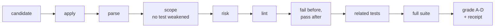

<!-- mcp-name: io.github.AdityaTummuri/qedcode -->
<div align="center">

<picture>
  <source media="(prefers-color-scheme: dark)" srcset="https://raw.githubusercontent.com/AdityaTummuri/QEDCode/main/assets/logo-dark.svg">
  
</picture>

### The proof layer for AI-written code

**QEDCode makes AI show its work: every code change gets a grade, a reason and a receipt anyone can
re-run.** Small local models. Proven fixes.

[](https://github.com/AdityaTummuri/QEDCode/actions/workflows/ci.yml)
[](https://pypi.org/project/qedcode/)


[Docs](https://adityatummuri.github.io/QEDCode/docs/) ·
[Try it in your browser](https://adityatummuri.github.io/QEDCode/play/) ·
[Results](https://github.com/AdityaTummuri/QEDCode/blob/main/docs/results.md) ·
[Start here if you use Claude Code or Cursor](https://github.com/AdityaTummuri/QEDCode/blob/main/docs/start-here.md) ·
[Open in Codespaces](https://codespaces.new/AdityaTummuri/QEDCode?quickstart=1)

</div>

<p align="center">
  
</p>

AI agents say "fixed" when it isn't, or turn tests green by weakening them. QEDCode never takes a
model's word for it. It asks for several candidate changes, tests each one in a throw-away copy of
your project, and hands you only the best **verified** change: graded A to D, explained in plain
English, with a receipt `qed verify` re-runs on any machine.

## Try it

```bash
uvx qedcode try                       # 1. a guided demo on a tiny buggy project (no GPU, ~1 min)
uvx qedcode check                     # 2. grade the uncommitted changes in your repo (no model)
uv tool install qedcode && qed setup  # 3. the full tool: a local model writes proven fixes
```

Then `qed` in any git repository opens the terminal UI, or `qed solve "fix the login bug"` from a
script. Nothing touches your files until you apply, and `qed undo` takes it back out.

## How a change is judged

Every candidate walks the same ladder, cheapest check first. The first failure rejects it with the
reason, and one function writes every grade:



| Grade | Meaning |
| --- | --- |
| **A** Proven | a test failed before, passes now, the full suite shows no regressions, nothing protected changed |
| **B** Tested | the tests pass, but nothing proved the exact problem |
| **C** Checked | it parses and lints, but no test covers it, or a test was weakened |
| **D** Not checked | nothing could run, and it says why |

## Results

<!-- results:start -->
Real-model numbers are being measured with [QEDCode Benchy](https://github.com/AdityaTummuri/QEDCode-benchy)
on local hardware: resolution lift, grade honesty, silent failures and whether 4B + QEDCode matches
9B alone. See [what is measured and how](https://github.com/AdityaTummuri/QEDCode/blob/main/docs/results.md); nothing is published before it is run.
<!-- results:end -->

## Works with

Claude Code · Cursor · OpenCode · Cline · Antigravity · VS Code (through MCP: `qed connect`) ·
GitHub Actions ([QEDCode Check](https://github.com/AdityaTummuri/QEDCode/blob/main/docs/github-action.md)) · pre-commit · llama.cpp · Ollama ·
LM Studio · any cloud model through LiteLLM. Python (pytest) and JavaScript/TypeScript
(`node --test`, Vitest, Jest) projects on macOS, Linux and Windows.

## Learn more

| | |
| --- | --- |
| [Install](https://github.com/AdityaTummuri/QEDCode/blob/main/docs/install.md) | per-OS install, first run, `qed doctor`, tested hardware |
| [Using QEDCode](https://github.com/AdityaTummuri/QEDCode/blob/main/docs/usage.md) | every command, the speed dial, languages, models and modes |
| [Agents](https://github.com/AdityaTummuri/QEDCode/blob/main/docs/agents.md) | use it from Claude Code, Cursor, Antigravity and others |
| [GitHub Action](https://github.com/AdityaTummuri/QEDCode/blob/main/docs/github-action.md) | grade every pull request; pre-commit hook |
| [How it works](https://github.com/AdityaTummuri/QEDCode/blob/main/docs/how-it-works.md) | the ladder, the grade rules, how it compares, architecture |
| [Safety model](https://github.com/AdityaTummuri/QEDCode/blob/main/docs/safety.md) | worktrees, a model that never runs commands, receipts as data |
| [Receipts](https://github.com/AdityaTummuri/QEDCode/blob/main/docs/receipts.md) | the open proof format and the Receipt Viewer |
| [FAQ](https://github.com/AdityaTummuri/QEDCode/blob/main/docs/faq.md) and [Troubleshooting](https://github.com/AdityaTummuri/QEDCode/blob/main/docs/troubleshooting.md) | |

<!-- stats:start -->
<!-- stats:end -->

## Develop

```bash
uv sync && uv run pytest -m "not gpu"     # no GPU, no network: a scripted model stands in
```

The build rules live in [AGENTS.md](https://github.com/AdityaTummuri/QEDCode/blob/main/AGENTS.md); [PROGRESS.md](https://github.com/AdityaTummuri/QEDCode/blob/main/PROGRESS.md) records what is done and
what still needs real hardware. See [CONTRIBUTING.md](https://github.com/AdityaTummuri/QEDCode/blob/main/CONTRIBUTING.md).

## License

[Apache License 2.0](https://github.com/AdityaTummuri/QEDCode/blob/main/LICENSE); see [NOTICE](https://github.com/AdityaTummuri/QEDCode/blob/main/NOTICE). Versions up to and including commit `a7fbe17`
were released under the GNU GPL-3.0.
