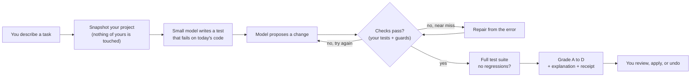
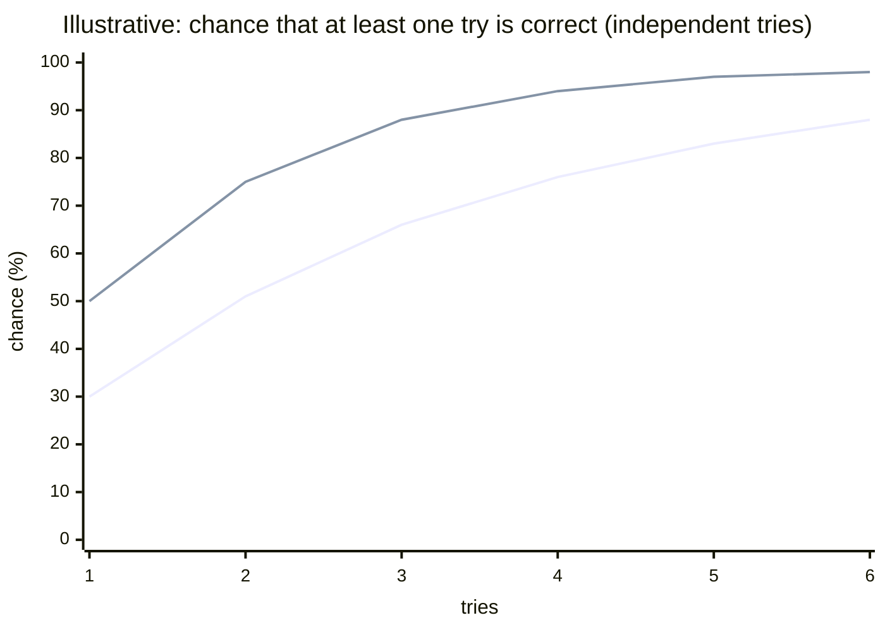
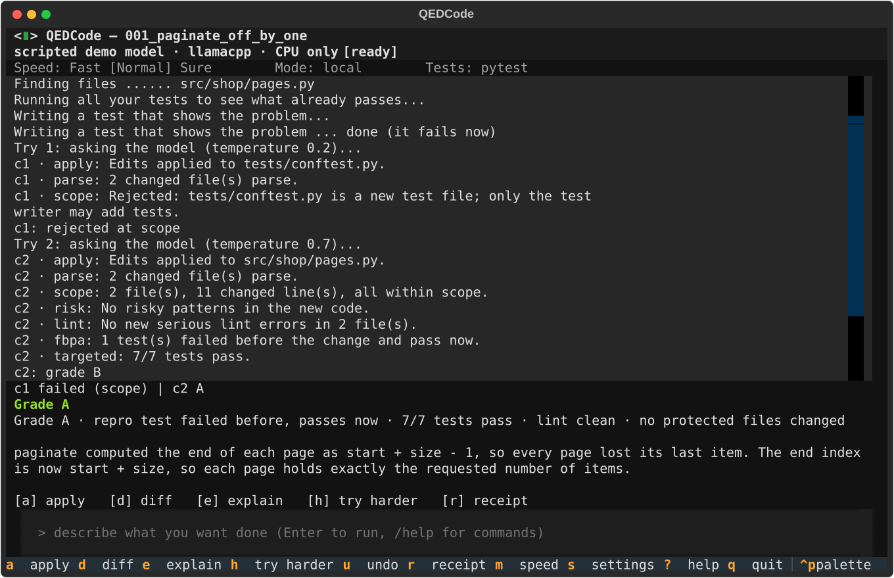
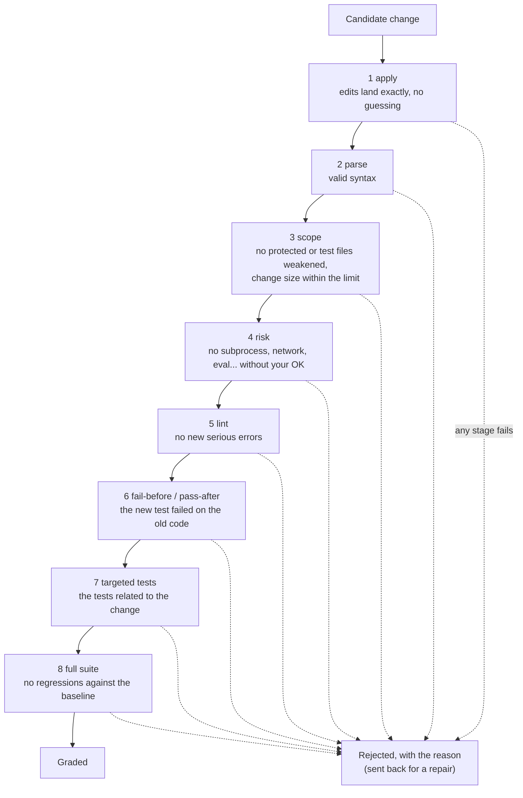
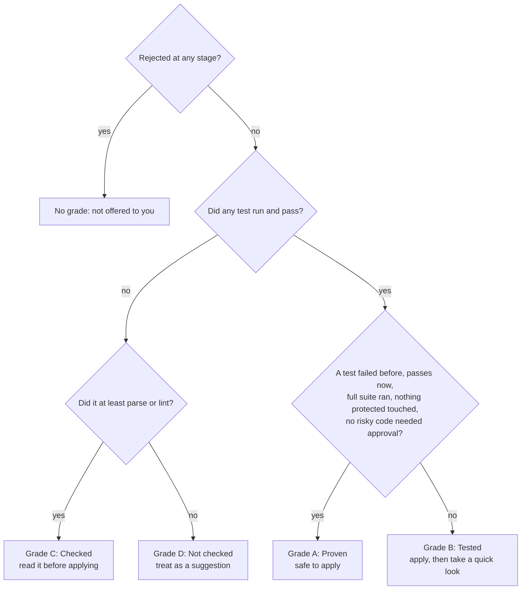
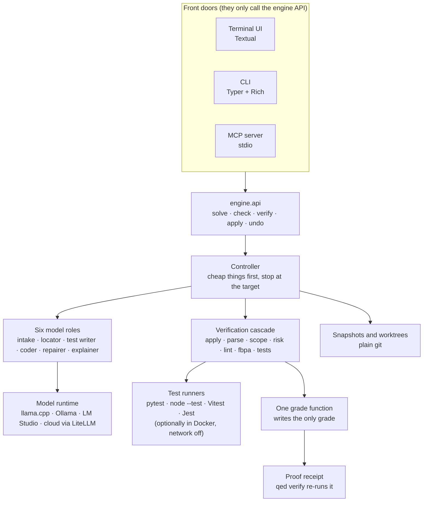
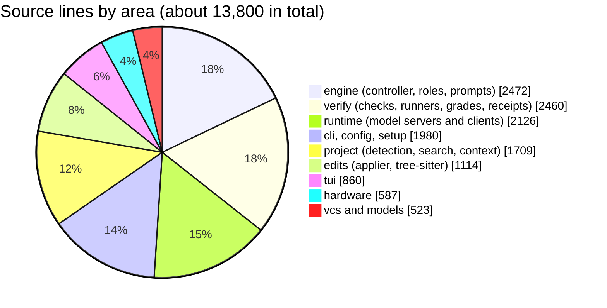

# How QEDCode works

## The name

**QED** is the Latin *quod erat demonstrandum*, "which was to be demonstrated": the line a
mathematician writes when a proof is finished. That is the promise of this tool. A model *claims* a
fix; QEDCode makes it *demonstrate* the fix. A grade **A** is a finished proof: a test that failed
before the change passes after it, nothing else broke, and no test was weakened to get there.

## The idea in one picture

Small models (4–6 GB of VRAM) are fast and private, but they are wrong often enough that you cannot
trust a single answer. Checking an answer is far cheaper than writing a good one. QEDCode turns that
gap into reliability: **generate several, verify every one with deterministic tools, keep the best.**



Why that works, in numbers you can reason about. If one try is right with probability *p*, and
tries were independent, the chance that at least one of *k* tries is right is 1 − (1 − *p*)^*k*.
Verification is what lets you *use* that: without checks you cannot tell which try was the right one.



*The two lines are a model that is right 30% and 50% of the time on its first try. This is
arithmetic, not a measurement: real tries are correlated, so real curves are flatter. QEDCode's
speed dial stops at 1, 3 or 6 tries and quits as soon as a try is proven, so easy tasks stay quick.*

## A real session



This is the output of QEDCode working on one of its own test projects (a `paginate` function that
drops the last item of every page). It was recorded with the scripted stand-in model the automated
tests use, so it shows the engine's real behaviour and wording, not real-model speed or quality.

```text
$ qed solve "paginate drops the last item"
Taking a snapshot of your project...
Finding files ...... src/shop/pages.py
Running all your tests to see what already passes...
Writing a test that shows the problem ... done (it fails now)
Try 1: asking the model (temperature 0.2)...
  c1 · apply:    Edits applied to src/shop/pages.py.
  c1 · parse:    2 changed file(s) parse.
  c1 · scope:    2 file(s), 11 changed line(s), all within scope.
  c1 · risk:     No risky patterns in the new code.
  c1 · lint:     No new serious lint errors in 2 file(s).
  c1 · fbpa:     1 test(s) failed before the change and pass now.
  c1 · targeted: 7/7 tests pass.
Running all tests on c1...
  c1 · full:     7/7 tests pass.
Grade A · repro test failed before, passes now · 7/7 tests pass · lint clean · no protected files changed
```

```diff
 def paginate(items, page, size):
     start = (page - 1) * size
-    end = start + size - 1
+    end = start + size
     return list(items[start:end])
```

Along with the fix it adds the test that proves it, and saves a receipt. `qed verify` re-checks the
patch's checksum, then re-runs the tests on the original code and on the patched code in fresh
copies, and reports `VERIFIED` only if every recorded result still holds. A receipt is treated as
data, never as a list of commands: `qed verify` only runs your project's own test command on test
files inside the project, so a receipt someone hands you cannot start anything else:

```text
$ qed verify .qed/receipts/<task id>.json
VERIFIED
Grade A · repro test failed before, passes now · 7/7 tests pass · lint clean · no protected files changed
```

## How a candidate is judged

Every candidate walks the same ladder, **cheapest check first**. The first failing check rejects it,
so bad answers cost almost nothing, and only a strong candidate ever reaches the full test suite.



A single function decides the grade, and it never gives credit without evidence:



| Grade | Meaning | What to do |
| --- | --- | --- |
| **A** Proven | A test failed before, passes now, the full suite shows no regressions, nothing protected changed | Safe to apply |
| **B** Tested | The tests pass, but nothing proved the exact problem | Apply, then take a quick look |
| **C** Checked | The code parses (and lints for Python), but no test covers the change, or (`qed check`) a test was weakened | Read the change before applying |
| **D** Not checked | No check could run, and it says why | Treat it as a suggestion |

## How it compares

Different tools make different promises. This compares **what each design guarantees**, not how fast
or how smart any particular product is. Measured results, with their intervals, are on the
[results page](results.md).

| | Ask a model once | A general coding agent | **QEDCode** |
| --- | --- | --- | --- |
| Who decides the answer is right? | You, by reading it | The model, from its own run of the code | **Deterministic checks**: parse, lint, your tests, a test that failed before |
| Can the model run commands? | n/a | Yes, it chooses them | **No.** Only fixed commands built by QEDCode run |
| Where does generated code run first? | Your files, after you paste it | Often your working tree | **A throw-away git copy.** Your tree changes only on `apply`, and `undo` reverses it |
| Can it "pass" by weakening a test? | You may not notice | Possible | **Rejected:** editing, deleting or skipping existing tests is blocked |
| Evidence you can hand to someone | None | A chat log | **A proof receipt** that `qed verify` re-runs on any machine |
| Needs a big cloud model? | Usually | Usually | **No:** designed for 4–6 GB local models; cloud is opt-in |
| Your code leaves your computer? | Often | Often | **Never in local mode;** mix and cloud mode ask first |
| Learns from your project | No | Varies | **Yes:** applied fixes become examples, stored only on your computer |
| Works from your editor/agent | n/a | Is the agent | **Both:** terminal UI, CLI, and an MCP server that other agents call as a tool |

QEDCode is also **complementary**: Claude Code, OpenCode, Cline, Cursor, Antigravity and VS Code can
call it through MCP
(`qed connect`), so a large agent gets a verified, graded fix with a receipt instead of unchecked text.

## What you get

| | |
| --- | --- |
| **Proof, not promises** | Every result has a grade A–D, a plain-English explanation and a receipt that `qed verify` re-runs |
| **Your files stay yours** | Work happens in git worktrees; `qed apply` and `qed undo` are the only things that write to your tree, and they refuse if a file changed |
| **Built for small models** | Runs 2B–9B models in 4–6 GB of VRAM through llama.cpp, Ollama or LM Studio; cloud and a stronger helper model are optional |
| **Python and JS/TS** | pytest, `node --test`, Vitest and Jest; symbol-level edits with `ast` and tree-sitter |
| **Test tampering blocked** | A candidate cannot edit, skip or weaken existing tests to look green |
| **Speed dial** | `fast`, `normal` (default) and `sure`: one, three or six tries |
| **Learns your project** | Applied A/B fixes are shown to the local model as examples next time |
| **Sealed test box** | Optional: run tests in Docker with the network off |
| **Quiet mode** | Cooler, quieter laptop runs: fewer threads, low priority, short pauses |
| **Terminal UI, CLI and MCP** | One engine behind three front doors; one shared model server |
| **A doctor and a clean exit** | `qed doctor` fixes what it can explain; `qed uninstall --all` removes everything it installed |

## Under the hood



Two rules shape everything: **the engine never imports a UI** (so the terminal UI, the CLI and MCP
cannot drift apart), and **the model never runs commands** (it only returns text edits that a strict
applier checks).

| Layer | What we use |
| --- | --- |
| Language and packaging | Python 3.12, `uv`, hatchling |
| Terminal UI and CLI | Textual, Typer, Rich |
| Data and config | Pydantic v2, TOML, YAML |
| Local models | llama.cpp (`llama-server`), Ollama, any OpenAI-compatible server (LM Studio) |
| Cloud models | LiteLLM; keys live in the OS keychain (`keyring`) |
| Code understanding | Python `ast`, tree-sitter (JavaScript, TypeScript) |
| Testing and linting of your project | pytest, `node --test`, Vitest, Jest, ruff |
| Hardware and processes | psutil, nvidia-ml-py (optional), HTTP via httpx, Hugging Face Hub for model downloads |
| Agent integration | Model Context Protocol (MCP) |
| Isolation | git worktrees; optional Docker with `--network none` |

It is a real piece of software, not a prototype. The current size and test count are in the
README's stats block, which the release workflow regenerates; no test needs a GPU, a network or a
real model. The chart below is a snapshot from 2026-11-21.


