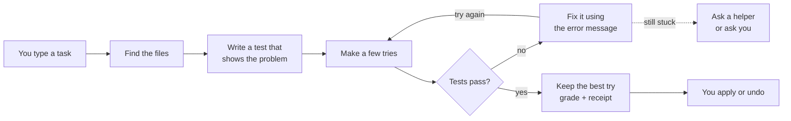

# QEDCode: what it is

*Written Nov 20, 2026 (converted from the original Word document). The "Future features" table
shows what has shipped since.*

## What is QEDCode?

QEDCode is a free coding helper that makes small AI models reliable. It tries several fixes, tests
each one, and keeps only the fix that is proven to work.

It runs on your own computer, even a cheap laptop with a 4–6 GB graphics card. You can use it alone
in the terminal, or plug it into tools like Claude Code and OpenCode.

**The problem.** Small AI models fit on cheap laptops, but they make many mistakes. Most coding
tools take the model's first answer and say "done", so you find the bugs later.

**The idea.** Don't trust the first answer. QEDCode asks the model for a few tries, runs your
project's tests on each one, and keeps the one that passes. Every result comes with an honest
grade, so you know how much to trust it.

**Why this works.** One try from a small model is often wrong, but one of several tries is often
right. In one study on real GitHub issues, the share solved by at least one try rose from 15.9%
with one try to 56% with 250 tries ([source](https://arxiv.org/abs/2407.21787)). QEDCode's job is
to find the right try and prove it.

**What it is not.** QEDCode is not a new AI model and not a chat assistant. It is a focused agent:
a manager program that uses free AI models to make code changes you can trust.

## How it works



Every try is tested in a safe copy of your project. If no try passes, QEDCode repairs the best one
using the error message; if it is still stuck, it asks a helper model (mix mode) or asks you a
clear question.

## What you see

You open your project folder in a terminal and type `qed`. A simple screen opens, you type what you
want, and QEDCode shows its tries and the result.

```text
+-- QEDCode -- my-project -------------------------------------+
| Model: Qwen3.5-4B  (local, NVIDIA 6 GB)            ready      |
| Speed: Normal            Tests found: pytest (48 tests)       |
+---------------------------------------------------------------+
| > fix the login bug                                           |
|                                                               |
|   Finding files ...... auth/login.py, tests/test_login.py     |
|   Writing a test that shows the bug ... done (it fails now)   |
|   try 1: failed (2 tests)   try 2: passed   try 3: passed     |
|                                                               |
|   Grade A - bug shown by a test, fixed, 48/48 tests pass      |
|                                                               |
|   [a] apply  [d] diff  [e] explain  [h] try harder  [u] undo  |
+---------------------------------------------------------------+
```

Your real files are not touched until you press **a** (apply). Until then, all work happens in a
safe copy of your project, and **u** (undo) takes an applied fix back out.

Every result gets a grade. The grade says how much proof QEDCode has, so you never get a fake
"done".

| Grade | What it means | What you should do |
| --- | --- | --- |
| **A — Proven** | A test showed the problem, the fix solved it, and all other tests still pass | Safe to apply |
| **B — Tested** | The tests pass, but no test proved the exact problem | Apply, then take a quick look |
| **C — Checked** | The code runs, but no test covers the change | Read the change before applying |
| **D — Not checked** | QEDCode could not run any checks, and it tells you why | Treat it as a suggestion |

You choose speed or certainty with the speed dial. QEDCode stops as soon as a try passes, so easy
tasks stay quick even on Sure.

| Speed | What it does | Rough time on a 6 GB laptop (a guess until measured) |
| --- | --- | --- |
| **Fast** | 1 try, quick checks | About 1 minute |
| **Normal** | Up to 3 tries, writes a test first for bugs and new features, runs all tests | 3–6 minutes |
| **Sure** | Up to 6 tries, always writes a test first, aims for grade A | 8–15 minutes |

Each result also comes with a short explanation in plain English (press **e**) and a proof
receipt: a small file listing every check that ran. Anyone can re-run the receipt with
`qed verify` to confirm the proof.

## Two ways to use it

QEDCode works alone, and it also works inside the coding agents you already use. It is the same
engine behind two doors.

**1. Alone, in the terminal.** Type `qed` in your project folder to open the screen, or run a
single command:

```bash
qed solve "fix the login bug"   # do a task and prove it
qed check                       # grade changes you made yourself
qed verify receipt.json         # re-check someone's proof
```

**2. Inside other agents.** Claude Code, OpenCode, Cline, Cursor and other agents can call
QEDCode as a tool through MCP, the standard way to add tools to AI agents. You connect it once:

```bash
claude mcp add qedcode -- qed mcp
```

Then just ask your agent, for example: "Fix the login bug with qedcode and prove it." The agent
gets back the fix, its grade and the proof receipt.

**Check my work.** Your agent can also ask QEDCode to grade the changes it wrote itself, before it
tells you "done". This helps even people who use big cloud models, because big models make
mistakes too.

**Why not a full chat agent?** Tools like Claude Code have whole teams building chat, plugins and
hundreds of features. QEDCode does one job very well, proven code changes, and lets those tools
handle the rest. That keeps it small, stable and easy to maintain.

## Where the AI runs, and what you need

QEDCode is built for local AI first. A mix mode and a cloud mode are there for people who want
them.

| Mode | Where the AI runs | Cost | Best for |
| --- | --- | --- | --- |
| **Local** | Your graphics card or Mac chip | Free | Privacy, offline work, cheap laptops |
| **Mix** | Local first; a bigger helper only when stuck | Mostly free | Hard tasks on small hardware |
| **Cloud** | An API you choose, with your own key | You pay the provider | No graphics card, or you prefer the cloud |

**Supported hardware.** NVIDIA, AMD, Intel and Apple M-series graphics all work, and so does
CPU-only (slow, but it works). The main target is 4–6 GB of video memory. QEDCode detects your
hardware, and you can always change what it picked.

**Setup is one command.** `qed setup` asks a few simple questions:

```text
qed setup

  Found: NVIDIA GeForce RTX 4050 Laptop GPU, 6 GB      (wrong? change it)

  Where should the AI run?
    1) On this computer (free, private)
    2) Mix: local first, helper when stuck
    3) Cloud API (needs your key)

  Recommended model for your card: Qwen3.5-4B (about 3 GB)
    1) Download it now
    2) Choose a different model
    3) Use a model I already have (Ollama, LM Studio, a file)
    4) Skip for now

  Connect QEDCode to Claude Code now? [y/N]
```

It always asks before downloading. If something is missing, like the model engine, a model or a
test tool, QEDCode shows a list with sizes and asks once. It never installs risky things like
graphics drivers or Docker by itself; it shows a short guide instead.

Everything lives in one folder (`~/.qedcode`), so `qed uninstall --all` removes it cleanly. When
you close QEDCode, the model leaves your graphics memory, so your games and apps get it back.

## What is in version 1

Version 1 does one thing end to end: proven fixes for Python projects that use pytest.

- The `qed` screen in any project folder, plus the commands `qed solve`, `qed check` and
  `qed verify`
- Several tries, automatic testing, best fix kept, with a repair round when a try almost works
- A test that shows the bug first, written by QEDCode (Normal and Sure speeds)
- Grades A–D and proof receipts that anyone can re-check
- Safe copy, apply and undo: your files change only when you say so
- A plain-English explanation of every fix
- The speed dial: Fast, Normal, Sure
- Local, mix and cloud modes on NVIDIA, AMD, Intel, Apple or CPU
- One-command setup that asks before every download
- Works with models you already have in Ollama, LM Studio or a model file
- Works inside Claude Code, OpenCode, Cline and other MCP agents

**Two honest limits in version 1.** It only understands Python. Tests run on your computer the
same way you would run them yourself; a fully sealed test box comes in a later version. (Both are
lifted in v1.1: JavaScript/TypeScript and the sealed test box have shipped.)

## Future features (after version 1)

These features come after version 1, one at a time, roughly in this order. Each one builds on the
same engine: try, test, prove.

| Feature | What it does | Planned for | Status |
| --- | --- | --- | --- |
| Learns your project | Remembers every proven fix in your project and uses them as examples next time. Stays on your computer. | v1.1 | Shipped |
| More languages | JavaScript and TypeScript first, then Go, Rust and Java | v1.1 | JS/TS shipped |
| Sealed test box | Runs tests inside a container with no internet, so even a bad test can't harm your computer | v1.1 | Shipped |
| Quiet mode | Limits heat, fan noise and battery use on laptops | v1.1 | Shipped |
| One-click agent connect | Setup connects OpenCode, Cline and Cursor automatically, not only Claude Code | v1.1 | Shipped |
| Safety Net Builder (`qed tests`) | Finds code with no tests and writes tests for it, keeping only tests that really work | v1.2 | |
| Bug Hunter (`qed hunt`) | Scans your project for real bugs, proves each one with a failing test, then offers a proven fix | v1.2 | |
| Watch Mode | When a test breaks while you code, it quietly finds a proven fix in the background | v1.2 | |
| Smart questions | When good tries disagree, it shows you one example ("should this return A or B?") and turns your answer into a test | v1.2 | |
| Night Shift (`qed night`) | Queue tasks before bed; your laptop works through them and leaves a morning report | v1.3 | |
| Web dashboard (`qed ui`) | A clean local web page with task cards, diffs and grades | v1.3 | |
| Big Brain mode | For very hard tasks, briefly loads a much bigger model that also uses your system memory. Slow, but smarter. | v1.3 | |
| Deep check | `qed check` also writes new tests, to check code from other people or other AIs harder | v1.3 | |
| Proof badges for pull requests | Posts the grade and receipt on GitHub pull requests, so your team sees the proof | v2 | |
| Smart speed | Learns from past tasks and picks the number of tries for you | v2 | |
| Trained helpers | Small add-ons trained on your proven fixes make the model better at your kind of work | v2 | |
| Comment checker | Finds comments that no longer match the code | v2 | |
| Leaderboard (opt-in) | Anonymous results from users build a public list of the best AI models for 4 GB and 6 GB cards | v2 | |
| Offline install pack | Download everything once, then install on a computer without internet | v2 | |
| Stop-or-continue judge | A tiny TRM-style model that predicts whether one more try will work, to save time. Kept only if it beats simple methods. | Research | |

## Questions people ask

**Is QEDCode an AI model?** No. It is an agent, a manager program. It uses existing free models
(like Qwen) and checks everything they write.

**Can a small model beat a big one?** Not in general knowledge. It can be more reliable on tasks
that have tests, because every answer is tested before you see it.

**Is it slower than other tools?** Yes, a bit, because it tests every try. It stops as soon as a
try passes, so only hard tasks take longer. A fast wrong answer costs you more time later.

**Does it change my code without asking?** Never. It works in a safe copy. Your files change only
when you press apply, and undo takes the change back out.

**Does my code leave my computer?** Not in local mode. In mix or cloud mode, the parts of your code
sent to the helper or cloud model leave your computer.

**Do I need internet?** Only for setup downloads. After that, local mode works fully offline.

**Do I need a graphics card?** No, but it is much faster with one. CPU-only works for small tasks
if you are patient.

**My project has no tests. Will it still help?** Yes, but less. QEDCode writes a test for your task
(Normal and Sure speeds). When nothing can be tested, the grade drops to C, so you know to check the
change yourself.

**Can I use my own API key?** Yes, in mix or cloud mode. You pick the provider and pay them
directly. Keys are stored safely by your system, not in plain files.

**Which languages work?** Python in version 1. JavaScript and TypeScript come next.

**What happened to HRM and TRM?** Their best idea (try, check, improve, stop when it is proven) is
the heart of QEDCode. The networks themselves only solve grid puzzles and cannot read code, so they
are a later research experiment.

**Do code comments help the AI?** A little. Good docstrings help the model understand your code,
and wrong comments mislead it. QEDCode reads your comments as hints and keeps the comments it adds
short.

## Why the name, and simple words

QED stands for the Latin *quod erat demonstrandum*, "which was to be demonstrated".
Mathematicians write it, or the symbol ∎, at the end of a finished proof. QEDCode ends every fix
with proof. The command is simply `qed`.

| Word | Simple meaning |
| --- | --- |
| Agent | A program that works on a task by itself, step by step |
| Model | The AI "brain" that writes code, like Qwen3.5-4B |
| Try | One attempt by the model to do the task |
| Test | A small program that checks whether code works |
| Grade | A to D: how much proof QEDCode has for a fix |
| Proof receipt | A small file listing every check that ran, so anyone can re-check it |
| Safe copy | A private copy of your project where tries happen |
| Speed dial | Fast, Normal or Sure: you choose speed or certainty |
| Helper | A bigger model used only when the small one is stuck (mix mode) |
| MCP | The standard way to plug tools into AI agents |
| VRAM | Your graphics card's own memory; the model has to fit in it |
